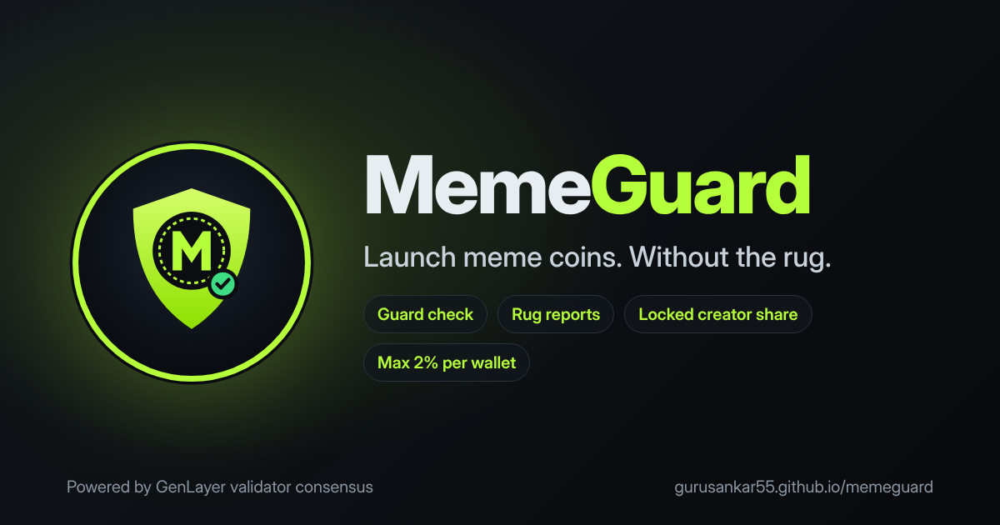

# MemeGuard Launchpad

**A fair-launch meme coin launchpad where GenLayer validators check every coin before it can trade, keep watching it after launch, and release the creator's share only as the creator keeps their public promise.**

- Live demo: https://gurusankar55.github.io/memeguard/web/
- Intelligent Contract (GenLayer Studionet): `0x8c6C3ef5f1a01b4AEBa0b68b52c069F88e12D2b6`
- Contract source: [`contracts/meme_guard.py`](contracts/meme_guard.py)
- Frontend: [`web/index.html`](web/index.html) (no backend, the browser talks to the contract with `genlayer-js`)

## The trust problem

On meme coin launchpads anyone can launch a token in seconds. Buyers have no way to know if:

1. the coin copies a famous coin or brand to trick them,
2. the website even belongs to the person launching the coin,
3. the website turns into a scam page after launch,
4. the creator will dump their share as soon as people buy,
5. one wallet (often the creator's) will buy up most of the supply.

Today this is judged by each buyer alone, or by one centralised moderator. MemeGuard turns these judgements into on-chain decisions made by GenLayer validator consensus, based on the live website.

## How it works

| Step | What happens | Who decides |
|---|---|---|
| 1. Create | Creator gives name, symbol, website, public promise, optional logo. Max supply is fixed at **1,000,000,000** for every coin. The contract gives a personal **verify line** (`memeguard-verify:<symbol>:<wallet>`). | Contract rules |
| 2. Guard check | Every validator opens the website itself. If the verify line is missing → `NO_PROOF`. Otherwise an LLM classifies the page as `OK`, `IMPERSONATION`, `MISMATCH` or `SCAM_SIGNS`. Validators must agree exactly (`strict_eq`). Only `OK` makes the coin `LIVE`. | GenLayer validators |
| 3. Trade | Buy and sell on a bonding curve: price rises with every buy and falls with every sell (up to 5x at full sale). Every trade is stored on-chain and drawn as a candle chart. | Contract rules |
| 4. Rug report | Anyone can report a live coin once, with a short written reason. Validators re-read the website. If the verify line was removed or the page now shows scam signs, the coin becomes `FROZEN`: buying stops, holders can still sell, the creator share stays locked. | GenLayer validators |
| 5. Creator unlock | The creator's 5% (50M) unlocks in **4 parts of 12.5M**. Each part needs (a) enough real demand: 10% / 25% / 50% / 75% of the sale supply sold, and (b) a validator check that the website shows the promise fulfilled, still has the verify line and has no scam signs. "Coming soon" does not count. | Contract rules + GenLayer validators |

Supply split per coin: 950,000,000 for sale (bonding curve) + 50,000,000 creator share (locked, unlocked in 4 parts).

Fair launch: no wallet can buy more than 2% of max supply (20,000,000 tokens), and the creator's wallet cannot buy its own coin. Each coin shows its holder count and top holder share.

Spam limits: one `PENDING` coin and three active (not rejected) coins per wallet. If a coin is rejected only because the verify line was missing or the site could not be read, its creator can fix the website and retry the guard check (3 retries). A 0.1 GEN launch fee is paid with `create_coin` and seeds the coin's pool.

### Real GEN

Trading uses real test GEN on Studionet. `create_coin` and `buy` are payable: the GEN sent with the call goes into that coin's own pool (`pool_wei`). `sell` computes the payout on the bonding curve, takes it from the coin's pool and adds it to the seller's claimable balance (pull payments). `withdraw()` clears that balance first and then sends the GEN to the seller's wallet with `emit_transfer`, so a sell can never fail because of a transfer and no one can withdraw twice. A coin can never pay out more than its own pool holds, and the contract has no withdraw or admin method, so nobody can drain a pool except by selling tokens they hold. A failed transaction returns the GEN that was sent.

## Why GenLayer is needed

Each of these decisions depends on what a live web page says right now: "is this page about this coin", "is this a copy of DOGE", "does this page show the recipe site is live". A normal smart contract cannot read the web, and an oracle cannot judge meaning. GenLayer validators read the page independently and only store a result they all agree on.

### Consensus design

- Model answers are reduced to a fixed vocabulary (`OK / IMPERSONATION / MISMATCH / SCAM_SIGNS / NO_WEBSITE / NO_PROOF`, or `YES / NO`), so `gl.eq_principle.strict_eq` can require exact agreement. Anything outside the vocabulary becomes `SCAM_SIGNS` (fail closed).
- The ownership proof is a plain substring check done before any model call, so it is deterministic.
- Page text is fenced as untrusted data; a page that tries to instruct the model to approve is classified as `SCAM_SIGNS`.

## Contract methods

| Method | Type | Description |
|---|---|---|
| `create_coin(name, symbol, website, promise, logo_url)` | write, payable (0.1 GEN) | Creates a `PENDING` coin and its verify line |
| `guard_check(coin_id)` | write, validators | Reads the website, sets `LIVE` or `REJECTED` with a reason |
| `cancel_coin(coin_id)` | write | Creator cancels a coin that is still `PENDING` (for example a wrong link); the launch fee is kept as the anti-spam cost |
| `buy(coin_id)` | write, payable | Spends the GEN sent with the call (0.1-100 GEN) on the bonding curve; max 2% per wallet; not the creator |
| `sell(coin_id, token_amount)` | write | Sells tokens back to the coin's pool; the GEN payout is added to the seller's claimable balance. Allowed for `LIVE` and `FROZEN` coins |
| `withdraw()` | write | Sends all claimable GEN to the caller's wallet |
| `report_coin(coin_id, reason)` | write, validators | Re-check of a live coin with a short written reason (5-200 chars). The reason is given to validators only as an unverified hint, fenced as untrusted text; the verdict comes from the live website. Stored on the coin as a public report history; can freeze the coin |
| `claim_creator_share(coin_id)` | write, validators | Unlocks the next 12.5M part of the creator share |
| `get_all_coins()` / `get_coin(coin_id)` | view | Coin data as JSON, including the trade history |
| `get_holders(coin_id)` | view | Holder count and top 5 holders with their share |
| `balance_of(coin_id, address)` | view | Token balance |
| `claimable_of(address)` | view | GEN (wei) waiting to be withdrawn |

## Frontend

`web/index.html` is a single page with no backend. It uses `genlayer-js` to read the contract and to send transactions from the user's wallet (MetaMask). Each write shows the full lifecycle: wallet signature → sent to GenLayer → validators reaching consensus → finished, and shows the contract error if a transaction is rejected.

Features: create form with image upload for the logo (resized to 64x64 in the browser and stored with the coin), withdraw box, holder count and top holder %, coin list with filters (Live / Pending / Rejected / Frozen), verify line with copy button, price and candle chart, recent trades, supply bar, trust badges, report button, 4-part creator unlock, roadmap menu.

## Run it yourself

```bash
# 1. Deploy the contract to Studionet
genlayer network set studionet
genlayer deploy --contract contracts/meme_guard.py

# 2. Put the contract address into web/index.html (const CONTRACT = "...")

# 3. Serve the website (MetaMask does not work on file:// pages)
npx serve web
```

## Try the full flow

1. Make a public page about your coin (for example a GitHub Gist) with its name and symbol.
2. Create the coin on MemeGuard and copy the verify line shown on the card.
3. Add the verify line to your page, then press **Run guard check** → the coin becomes `LIVE`.
4. Buy and sell to see the price chart move.
5. Remove the verify line or add "guaranteed 10x profit" to the page, then **Report** from another wallet → the coin becomes `FROZEN`.

## Evidence

Screenshots are in [`docs/screenshots`](docs/screenshots). They show coins rejected for an unrelated website, a coin passing the guard check, trading with the candle chart, and a report that was cleared.

## Limits (honest scope)

- Runs on GenLayer Studionet with test GEN. Test GEN really moves from wallets into coin pools (launch fee and buys). The meme coins themselves are balances inside the contract, not separate token contracts. This is a prototype, not financial advice and not a real token sale.

### Known limitation: contract-to-wallet payouts on Studionet

Sells work and move GEN from the coin's pool to the seller's on-chain claimable balance. `withdraw()` also succeeds and emits the transfer to the seller's wallet, but **Studionet does not credit it yet**: the triggered transfer is routed to `contract_not_found_handler` and ends with `value_credited: false`, because the receiver is a wallet, not a contract.

Evidence from the final deployment (`0x8c6C3ef5f1a01b4AEBa0b68b52c069F88e12D2b6`):

| Transaction | Result |
|---|---|
| `withdraw()` `0x6705cb89725b57331375cb34f5344b3d913412e0e73a5436643ef15cf751ea9f` | `SUCCESS`, emitted message to `0xC1E4…29F6` with value 0.8496 GEN |
| Triggered transfer `0x2913569206007642cb8d9f63f55e1b97c4e83ab96a8a7ea5b15fcfe2ef0b7312` | `last_leader: contract_not_found_handler`, `NO_MAJORITY`, `value_credited: false` |
| `withdraw()` `0x4aff428758c0c384b31706504582b765677f822152609896fade2296d0af071a` (after re-enabling Withdraw) | `SUCCESS`, emitted message to `0xC1E4…29F6` with value 0.05 GEN |
| Triggered transfer `0xe7d708b2f82fa67a4698286b52c70027be863d0d3979d03c7bca0ffa7f915429` | `last_leader: contract_not_found_handler`, `NO_MAJORITY`, `value_credited: false` |

The same behaviour is reported in [genlayerlabs/genvm-manager#20](https://github.com/genlayerlabs/genvm-manager/issues/20). The full payout workflow is wired end to end in source and in the website: **Sell** moves the payout from the coin's pool to the seller's claimable balance, the **Withdraw to wallet** button calls `withdraw()`, which clears the balance and calls `gl.get_contract_at(seller).emit_transfer(value=u256(amount))` (the same transfer API used by other GenLayer escrow projects), and the website shows the follow-up transfer transaction hash. No contract change is needed when the network credits these transfers to wallets.

Payout flow in source (`contracts/meme_guard.py`):

```python
# sell(): pool -> claimable
coin["pool_wei"] -= payout
claim[seller] = claim.get(seller, 0) + payout

# withdraw(): claimable -> wallet
claim[me] = 0                       # state cleared first, no double withdraw
_send_gen(gl.message.sender_address, amount)   # get_contract_at(to).emit_transfer(value=u256(amount))
```
- Validators judge what the website says. They cannot verify the team's identity or off-site activity.
- Very large or script-only pages may be read only in part (first 5,000 characters are judged).

## Roadmap

1. DEX listing for coins whose creator kept the promise.
2. Liquidity pool locked by validator checks.
3. Staking rewards for holders of coins with a clean record.
